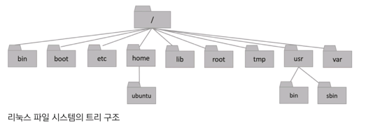
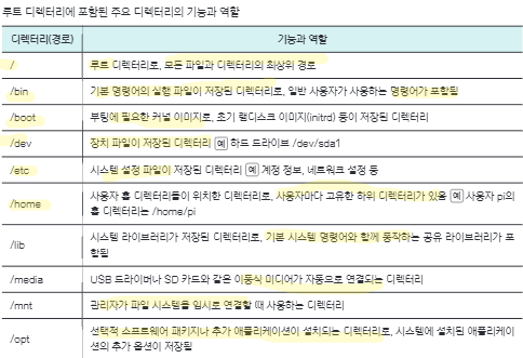
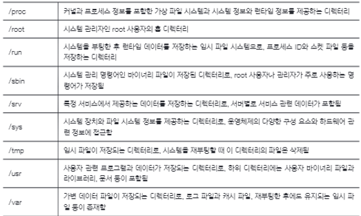

# 3. 파일 시스템과 경로
## 3.1. 리눅스 파일 시스템
### 리눅스 파일 시스템의 5가지 특징
- 대소문자 궂분
- 긴 파일명 지원
- 링크 파일 지원
    - 윈도우 바로가기와 유사
- 확장자가 파일 형식 강제하지 않음
-  파일과 디렉터리에 권한 있음
    -  읽기(read), 쓰기(write), 실행(execute)

### 리눅스 파일의 종류
-  일반 파일
-  가장 기본적인 파일
    - 텍스트 파일, 실행 파일, 바이너리 파일 등
- 통신 파일
    - 프로세스나 네트워크 통신에 사용
    - 소켓 파일: 네트워크 통신하거나 동일한 시스템 내에 프로세스 간 통신할 때 사용
    - 명명된 파이프 파일: 한 프로세스의 출력된 데이터를 다른 프로세스 입력으로 전달
- 링크 파일
    - 다른 파일이나 디렉터리에 쉽게 접근할 수 있게 만든 파일
- 장치 파일
    - 하드웨어 장치에 접근할 수 있는 인터페이스 역할

### 트리 구조




### getconf: 시스템 설정값과 환경설정 정보 확인
- `getconf [옵션] [변수] [경로]`: 시스템에 미리 정의된 제한이나 변수 확인
```bash
tls_desktop@tlsdesktop:~$ getconf PATH_MAX /home/tls_desktop
4096

```

### ls -l: 파일 유형과 식별자 확인
- `ls -l`: 현재 경로 내에 있는 파일 목록 확인
- 뒤에 특정 경로 붙이면 특정 경로 내의 파일 목록을 확인함

```bash
tls_desktop@tlsdesktop:~/linux$ touch test
tls_desktop@tlsdesktop:~/linux$ ls -l
total 0
-rw-r--r-- 1 tls_desktop tls_desktop 0 Oct 26 08:35 test
tls_desktop@tlsdesktop:~/linux$ ls -l /dev
total 0
crw-r--r-- 1 root root     10, 235 Oct 26 08:27 autofs
drwxr-xr-x 2 root root         600 Oct 26 08:27 block
drwxr-xr-x 2 root root         120 Oct 26 08:27 bsg
crw------- 1 root root     10, 234 Oct 26 08:27 btrfs-control
...(중략)...

```

## 3.2. 절대 경로와 상대 경로
### 절대 경로와 상대 경로란?
- 절대 경로: 루트 디렉터리부터 시작하는 전체 경로
    - 현재 위치와 상관없이 항상 고정됨
- 상대 경로: 현재 위치를 기준으로 지정하는 경로로 위치에 따라 달라질 수 있음

특수 문자 | 의미 | 예시
---|---|---
/ |루트 디렉토리 또는 경로 구분자 |/home/ubuntu
. |현재 디렉토리 |./filename
.. |부모(상위) 디렉토리 |../filename
~ |현재 사용자의 홈 디렉토리 |~/filename

### cd: 경로 이동
- `cd [경로]`: [경로]로 이동

```bash
tls_desktop@tlsdesktop:~/linux$ pwd #현재 디렉토리 확인
/home/tls_desktop/linux

tls_desktop@tlsdesktop:~/linux$ cd .. #부모 디렉토리로 이동
tls_desktop@tlsdesktop:~$ pwd
/home/tls_desktop
tls_desktop@tlsdesktop:~$ cd linux

tls_desktop@tlsdesktop:~/linux$ cd / #루트 디렉터리로 이동
tls_desktop@tlsdesktop:/$ ls
bin   dev  home  lib    lib64   lost+found  mnt  proc  run   snap  sys  usr  wslJcfkBP  wsljjGaBP  wslNFDlaN
boot  etc  init  lib32  libx32  media       opt  root  sbin  srv   tmp  var  wsljglDCP  wslJnhIAP

tls_desktop@tlsdesktop:/$ cd #홈 디렉터리로 이동
tls_desktop@tlsdesktop:~$ pwd
/home/tls_desktop
tls_desktop@tlsdesktop:~$ cd ~ # 홈 디렉터리로 이동
tls_desktop@tlsdesktop:~$ mkdir A # A 디렉토리 생성
tls_desktop@tlsdesktop:~$ cd A # A 디렉토리로 이동
tls_desktop@tlsdesktop:~/A$ mkdir B
tls_desktop@tlsdesktop:~/A$ cd B
tls_desktop@tlsdesktop:~/A/B$ mkdir C
tls_desktop@tlsdesktop:~/A/B$ cd C
tls_desktop@tlsdesktop:~/A/B/C$ pwd
/home/tls_desktop/A/B/C

tls_desktop@tlsdesktop:~/A/B/C$ cd /home/tls_desktop/A # 절대 경로를 사용해 A 디렉토리로 이동
tls_desktop@tlsdesktop:~/A$ pwd
/home/tls_desktop/A
tls_desktop@tlsdesktop:~/A$ cd /home/tls_desktop/A/B/C
tls_desktop@tlsdesktop:~/A/B/C$ pwd
/home/tls_desktop/A/B/C

tls_desktop@tlsdesktop:~/A/B/C$ cd ../../ # 상대 경로를 통해 A 디렉토리로 이동
tls_desktop@tlsdesktop:~/A$ pwd
/home/tls_desktop/A
tls_desktop@tlsdesktop:~/A$ cd B/C
tls_desktop@tlsdesktop:~/A/B/C$ pwd
/home/tls_desktop/A/B/C
tls_desktop@tlsdesktop:~/A/B/C$

```

## 3.3. 파일 복사하고 변경하기
### tree: 파일 생성하고 디렉터리 구조 확인하기
- `tree`: 현재 디렉토리 형태를 트리 구조로 출력
```bash
tls_desktop@tlsdesktop:~/linux$ mkdir -p A/B/C
tls_desktop@tlsdesktop:~/linux$ tree
.
├── A
│   └── B
│       └── C
└── test

3 directories, 1 file

```

### cp: 파일과 디렉토리 복사
- `cp [옵션] [원본 경로 또는 파일명] [복사본 경로 또는 파일명]`
    - 복사 위치에 경로만 쓰면 파일명은 그대로 유지한 채 복사함
    - 옵션이 ‘-r’이면 디렉토리를 복사

```bash
tls_desktop@tlsdesktop:~/linux$ cd ./A/B/C
tls_desktop@tlsdesktop:~/linux/A/B/C$ touch test1
tls_desktop@tlsdesktop:~/linux/A/B/C$ cd ~/linux
tls_desktop@tlsdesktop:~/linux$ cp ./A/B/C/test1 ./A/test2
tls_desktop@tlsdesktop:~/linux$ tls_desktop@tlsdesktop:~/linux$ mkdir -p A/B/C
tls_desktop@tlsdesktop:~/linux$ tree
.
├── A
│   └── B
│       └── C
└── test

3 directories, 1 file

```

```bash
# 원본 파일 이름을 유지한 상태로 복사
tls_desktop@tlsdesktop:~/linux$ cp ./A/B/C/test1 ./A/B
tls_desktop@tlsdesktop:~/linux$ tree
.
├── A
│   ├── B
│   │   ├── C
│   │   │   └── test1
│   │   └── test1
│   └── test2
└── test

3 directories, 4 files

```

```bash
# 디렉토리 복사
tls_desktop@tlsdesktop:~/linux$ cp -r ./A/B/C ./A/B/E
tls_desktop@tlsdesktop:~/linux$ tree
.
├── A
│   ├── B
│   │   ├── C
│   │   │   └── test1
│   │   ├── E
│   │   │   └── test1
│   │   └── test1
│   └── test2
└── test

4 directories, 5 files

```

### mv: 파일과 디렉토리 변경
- `mv [옵션] [변경 전 파일/디렉토리] [변경 후 파일/디렉토리]`: 파일과 디렉터리 변경

```bash
tls_desktop@tlsdesktop:~/linux$ mkdir ./A/B/C
mkdir: cannot create directory ‘./A/B/C’: No such file or directory
tls_desktop@tlsdesktop:~/linux$ mkdir -p A/B/C
tls_desktop@tlsdesktop:~/linux$ touch ./A/B/C/test
tls_desktop@tlsdesktop:~/linux$ tree
.
├── A
│   └── B
│       └── C
│           └── test
└── test

3 directories, 2 files
tls_desktop@tlsdesktop:~/linux$ mv ./A/B/C/test ./A/B/C/test1
tls_desktop@tlsdesktop:~/linux$ tree
.
├── A
│   └── B
│       └── C
│           └── test1
└── test

3 directories, 2 files

```
```bash
tls_desktop@tlsdesktop:~/linux$ # 디렉터리 이동
tls_desktop@tlsdesktop:~/linux$ mv ./A/B/C ./A/
tls_desktop@tlsdesktop:~/linux$ tree
.
├── A
│   ├── B
│   └── C
│       └── test1
└── test

3 directories, 2 files

```

```bash
tls_desktop@tlsdesktop:~/linux$ # 파일 이동
tls_desktop@tlsdesktop:~/linux$ mv ./A/C/test1 ./A/B
tls_desktop@tlsdesktop:~/linux$ tree
.
├── A
│   ├── B
│   │   └── test1
│   └── C
└── test

3 directories, 2 files

```