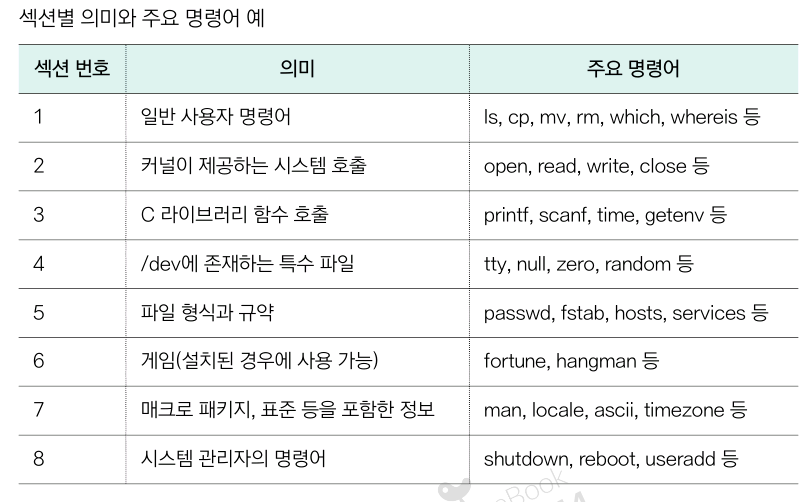

# 4. 리눅스 응용 명령어
## 4.1. 명령어 매뉴얼 확인하기
### 리눅스의 명령어 매뉴얼
- 명령어 매뉴얼: 각 명령어의 사용법과 옵션, 예시 등을 설명해주는 도움말 문서
- 명령어의 목적에 따라 섹션이라는 목록으로 분류됨
- 섹션 번호 사용하면 이름이 같은 명령어 중 특정 명령어 췹게 찾을 수 있음



### man: 명령어 매뉴얼 확인
- `man [옵션] [명령어]`: 리눅스 명령어 매뉴얼 확인

#### 매뉴얼 확인하기
```bash
$ man ls
```
```
LS(1)                                                                User Commands                                                               LS(1)

NAME
       ls - list directory contents

SYNOPSIS
       ls [OPTION]... [FILE]...

DESCRIPTION
       List information about the FILEs (the current directory by default).  Sort entries alphabetically if none of -cftuvSUX nor --sort is specified.

       Mandatory arguments to long options are mandatory for short options too.

       -a, --all
              do not ignore entries starting with .

       -A, --almost-all
              do not list implied . and ..

 Manual page ls(1) line 1 (press h for help or q to quit)
```
- NAME: 명령어 이름과 간단한 설명
- SYNOPSIS: 명령어 사용법
- DESCRIPSION: 상세 설명과 함께 사용할 수 있는 옵션
- f를 누르면 다음 페이지
- b를 누르면 이전 페이지
- q를 누르면 종료

### 섹션 번호로 매뉴얼 확인하기
- printf 명령어의 경우 일반 사용자 명령어(섹션1)에도 있고 C 라이브러리 함수(섹션 3)에도 있음

```bash
tls_desktop@tlsdesktop:~/Linux$ # 섹션 1의 printf
tls_desktop@tlsdesktop:~/Linux$ man 1 printf
```

```
PRINTF(1)                                                            User Commands                                                           PRINTF(1)

NAME
       printf - format and print data

SYNOPSIS
       printf FORMAT [ARGUMENT]...
       printf OPTION

DESCRIPTION
       Print ARGUMENT(s) according to FORMAT, or execute according to OPTION:

       --help display this help and exit

       --version
              output version information and exit

       FORMAT controls the output as in C printf.  Interpreted sequences are:

 Manual page printf(1) line 1 (press h for help or q to quit)
```

```bash
tls_desktop@tlsdesktop:~/Linux$ # 섹션 3의 printf
tls_desktop@tlsdesktop:~/Linux$ man 3 printf
```

```
PRINTF(3)                                                      Linux Programmer's Manual                                                     PRINTF(3)

NAME
       printf, fprintf, dprintf, sprintf, snprintf, vprintf, vfprintf, vdprintf, vsprintf, vsnprintf - formatted output conversion

SYNOPSIS
       #include <stdio.h>

       int printf(const char *format, ...);
       int fprintf(FILE *stream, const char *format, ...);
       int dprintf(int fd, const char *format, ...);
       int sprintf(char *str, const char *format, ...);
       int snprintf(char *str, size_t size, const char *format, ...);

       #include <stdarg.h>

       int vprintf(const char *format, va_list ap);
       int vfprintf(FILE *stream, const char *format, va_list ap);
       int vdprintf(int fd, const char *format, va_list ap);
```
#### 특정 키워드가 포함된 명령어 찾기
- 명령어 이름이 기억 안나면 `-k` 옵션 사용해 키워드 검색

```bash
tls_desktop@tlsdesktop:~/Linux$ man -k delete
```
```
tls_desktop@tlsdesktop:~/Linux$ man -k delete
argz_delete (3)      - functions to handle an argz list
delete_module (2)    - unload a kernel module
git-branch (1)       - List, create, or delete branches
...(중략)...
```

#### `--help` 옵션으로 간단한 사용법 확인하기
- 명령어 이름 뒤에 `--help` 옵션 붙이면 간단한 사용법과 주요 옵션 빠르게 확인 가능

```bash
tls_desktop@tlsdesktop:~/Linux$ ls --help
Usage: ls [OPTION]... [FILE]...
List information about the FILEs (the current directory by default).
Sort entries alphabetically if none of -cftuvSUX nor --sort is specified.
#...(중략)...
```

### `which`: 명령어 실행 파일 위치 확인
- `which [옵션] [명령어]`: 명령어의 실행 파일 위치가 어디있는지 확인
#### 실행 파일 위치 확인
```bash
tls_desktop@tlsdesktop:~/Linux$ which mkdir
/usr/bin/mkdir
```

#### 명령어의 모든 실행파일 위치 확인하기
- 프로그램이 여러 경로에 설치되있다면 -a 옵션 붙여서 모든 경로 확인
```bash
tls_desktop@tlsdesktop:~/Linux$ which -a mkdir
/usr/bin/mkdir
/bin/mkdir
```

### whereis: 명령어의 매뉴얼 위치 확인
- `whereis [옵션] [명령어]`: 명령어 매뉴얼이나 소스코드의 위치까지 알고싶을 때 사용
    - `which`와 비슷하나 더 많은 정보를 제공

#### 매뉴얼의 위치 확인
```bash
tls_desktop@tlsdesktop:~/Linux$ whereis ls
ls: /usr/bin/ls /usr/share/man/man1/ls.1.gz
```

#### 특정 정보만 출력
- `b`: 실행 파일 위치만
- `m`: 매뉴얼 위치만
- `s`: 소스코드 위치만
```bash
tls_desktop@tlsdesktop:~/Linux$ whereis -b  ls
ls: /usr/bin/ls
tls_desktop@tlsdesktop:~/Linux$ whereis -m ls
ls: /usr/share/man/man1/ls.1.gz
tls_desktop@tlsdesktop:~/Linux$ whereis -s ls
ls:
```

## 4.2. 명령어 사용 확인 및 파일 찾기
### 와일드카드 문자란?
- 와일드카드: 파일 시스템에서 특정 패턴과 일치하는 파일을 찾을 떄 사용하는 특수문자
    - *, ?, [], {} 등
    - ls, cp, mv와 같은 명령어와 조합해서 사용

### 와일드카드 문자 사용하기
- 시작 전 파일 만들어놓기
```bash
tls_desktop@tlsdesktop:~/Linux$ mkdir test
tls_desktop@tlsdesktop:~/Linux$ cd test/
tls_desktop@tlsdesktop:~/Linux/test$ touch tast1.txt
tls_desktop@tlsdesktop:~/Linux/test$ touch tast2.txt
tls_desktop@tlsdesktop:~/Linux/test$ touch tast3.txt
tls_desktop@tlsdesktop:~/Linux/test$ touch tast4.txt
tls_desktop@tlsdesktop:~/Linux/test$ touch test1.txt
tls_desktop@tlsdesktop:~/Linux/test$ touch test2.txt
tls_desktop@tlsdesktop:~/Linux/test$ touch test3.txt
tls_desktop@tlsdesktop:~/Linux/test$ touch test4.txt
tls_desktop@tlsdesktop:~/Linux/test$ tree
.
├── tast1.txt
├── tast2.txt
├── tast3.txt
├── tast4.txt
├── test1.txt
├── test2.txt
├── test3.txt
└── test4.txt
```
#### 와일드카드 문자 `?`
- `?`: 임의의 한 문자에 대응
- `?`가 위치한 아무 자리에 아무 문자 하나 넣을 수 있음
```bash
tls_desktop@tlsdesktop:~/Linux/test$ ls test?.txt
test1.txt  test2.txt  test3.txt  test4.txt
```

#### 와일드카드 문자 `*`
- `*`: 0개 이상의 문자열에 대응
- 어떤 문자든, 몇 글자든 상관없이 모두 대응
```bash
tls_desktop@tlsdesktop:~/Linux/test$ ls *.txt
tast1.txt  tast2.txt  tast3.txt  tast4.txt  test1.txt  test2.txt  test3.txt  test4.txt
```

####  와일드카드 문자 `[]`
- `[]`:  대괄호 안의 문자 중에서 하나와 일치하는 문자에 대응
- 대괄호 안 나열된 여러 문자 가운데 한 글자만 대응
```bash
tls_desktop@tlsdesktop:~/Linux/test$ ls t[ae]st1*
tast1.txt  test1.txt
```
- `-`: `[]` 안에서 문자나 숫자의 범위를 지정할 때 사용
```bash
tls_desktop@tlsdesktop:~/Linux/test$ ls test[1-3].txt
test1.txt  test2.txt  test3.txt
```

- `!`: [] 안에 지정된 문자로 시작하지 않는 모든 경우
```bash
tls_desktop@tlsdesktop:~/Linux/test$ ls tast[!1].txt
tast2.txt  tast3.txt  tast4.txt
```

#### 와일드카드 문자 `{}`
- `{}`: 